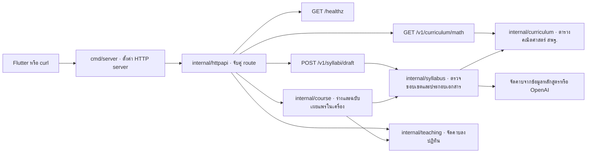

# PromptLearn Backend

Go HTTP service สำหรับใช้งานจาก Flutter ใช้ Go 1.24 ขึ้นไป เดโมคลิปย้อนหลังใช้ PostgreSQL ผ่าน pgx

## API Specification

[อ่าน API Reference (HTML)](api-spec/index.html) เพื่อดูขั้นตอนการเรียกและตัวอย่าง Request, Response และ Error ของแต่ละ endpoint เปิดไฟล์จากเครื่องได้โดยตรง

[OpenAPI 3.0.3 (YAML)](api-spec/openapi.yaml) ระบุ path, parameters, schemas และ HTTP status สำหรับนำเข้า Swagger UI หรือ Postman

[ตัวอย่าง curl สำหรับคลิปย้อนหลัง](api-spec/video-replay-curl.md) ครอบคลุมการอัปโหลด เผยแพร่ ดึง transcript และขอช่วงไบต์ของ MP4

ลำดับการเรียกสำหรับฝั่งครูคือดึงหลักสูตรและคำนวณจำนวนคาบ → สร้างร่าง → แก้หน่วยและคะแนน → ดูตัวอย่างตาราง → บันทึกและเผยแพร่ ฝั่งผู้เรียนเรียก `GET /v1/published-syllabi/{id}` เพื่ออ่านฉบับที่เผยแพร่ล่าสุด

เมื่อแก้ YAML ให้สร้างหน้า HTML ใหม่ด้วย `python3 api-spec/render_html.py` จากโฟลเดอร์ `backend/` โดยใช้ Python ที่ติดตั้ง PyYAML

## โครงสร้างโปรเจกต์

```text
backend/
├── cmd/server/
│   └── main.go          # ตั้งค่าและประกอบ dependency ก่อนเปิด HTTP server
├── internal/
│   ├── httpapi/         # routes, JSON requests/responses และ HTTP status
│   ├── course/          # ประกอบร่างพร้อมตาราง บันทึก และเผยแพร่ฉบับสำหรับผู้เรียน
│   ├── replay/          # ตรวจไฟล์และเก็บคลิปย้อนหลังกับ transcript ในเดโม
│   ├── curriculum/      # ข้อมูลคณิตศาสตร์จาก PDF ของ สพฐ. และคำแปลอังกฤษ
│   ├── syllabus/        # ร่างแผนรายเทอม ตรวจเงื่อนไข จัดหน่วยและคาบ และ render HTML
│   ├── teaching/        # คำนวณคาบ ตรวจวันหยุดและคาบซ้อน และลงคาบให้แต่ละห้อง
│   └── openai/          # HTTP client สำหรับ Responses API และ Structured Outputs
├── examples/           # JSON ตัวอย่างสำหรับลองเรียก API
├── api-spec/           # OpenAPI YAML, HTML API Reference และสคริปต์สร้างหน้าเอกสาร
├── .env.example        # แม่แบบ environment สำหรับรันในเครื่อง
└── go.mod              # Go module ของ backend
```

### เพิ่ม feature ใหม่

1. วางกติกาและลำดับการทำงานในแพ็กเกจของ feature ภายใต้ `internal/` ถ้า feature ใช้ Responses API ให้ใช้ client ใน `internal/openai/` และเก็บ prompt กับ schema ไว้ในแพ็กเกจของ feature
2. เพิ่ม HTTP handler ใน [`internal/httpapi/`](internal/httpapi/) ให้รับ JSON เรียกแพ็กเกจของ feature และคืนผลลัพธ์ จากนั้นลงทะเบียน route ใน [`router.go`](internal/httpapi/router.go)
3. ประกอบ dependency ที่ feature ต้องใช้ใน [`cmd/server/main.go`](cmd/server/main.go) และวางเทสไว้ในแพ็กเกจที่รับผิดชอบพฤติกรรมนั้น รัน `go test ./...` จาก `backend/`

คัดลอก `.env.example` เป็น `.env` เมื่อต้องตั้งค่าในเครื่อง Git ignore ทั้ง `.env` และ `.promptlearn-data/` ซึ่งเก็บข้อมูลเดโม

## รัน service

รันจากโฟลเดอร์ `backend/`

```sh
go run ./cmd/server
```

เปิดอีก terminal เพื่อเรียก endpoint

```sh
curl -i http://127.0.0.1:8080/healthz
```

`GET /healthz` ตอบ HTTP 200 พร้อม JSON `{"status":"ok"}` เมื่อ HTTP service รับคำขอได้

ค่าเริ่มต้นฟังที่ `127.0.0.1:8080` กำหนด `HTTP_ADDR=0.0.0.0:8080` ได้เมื่อต้องทดสอบจากอุปกรณ์ในเครือข่ายเดียวกัน

## รันเดโมคลิปย้อนหลัง

ต้องมี PostgreSQL 14 ขึ้นไป, `ffprobe` จาก FFmpeg และ Flutter จาก root ของ repo ให้สร้างฐานข้อมูลเดโมใหม่ด้วยการตั้งค่าการเชื่อมต่อ PostgreSQL ในเครื่อง

```sh
createdb promptlearn_replay
psql -X -v ON_ERROR_STOP=1 -d promptlearn_replay -f db_migration/schema.sql
psql -X -v ON_ERROR_STOP=1 -d promptlearn_replay -f db_migration/demo_seed.sql
```

Build Flutter Web แล้วเปิด Go ให้บริการหน้าเว็บและ API จาก origin เดียวกัน

```sh
(cd frontend && flutter build web --no-web-resources-cdn)
cd backend
REPLAY_DEMO_DATABASE_URL='postgresql:///promptlearn_replay' \
REPLAY_DEMO_WEB_DIR='../frontend/build/web' \
SYLLABUS_PLANNER=mock go run ./cmd/server
```

1. เปิด `http://127.0.0.1:8080` ใน Chrome เลือก **Login as Teacher** แล้วเปิด **Courses**
2. เลือก [คลิปตัวอย่างภาษาไทย](examples/thai-lesson.mp4) และ [transcript ที่เตรียมไว้](examples/thai-lesson.transcript.json) กด **อัปโหลด** แล้วกด **เผยแพร่**
3. กดโลโก้เพื่อสลับเป็น **Login as Student** เปิด **Courses** แล้วกดเวลาใน transcript เพื่อกระโดดไปยังช่วงนั้นของคลิป

เดโมเปิด route เมื่อกำหนด `REPLAY_DEMO_DATABASE_URL` และรับเฉพาะการเชื่อมต่อ loopback บทบาทที่เลือกใน UI ใช้เพื่อสาธิตในเครื่อง ไฟล์อยู่ใต้ `PROMPTLEARN_DATA_DIR/replay` โดยค่าเริ่มต้นเป็น `.promptlearn-data/replay` ส่วนสถานะเผยแพร่และ transcript อยู่ใน PostgreSQL

ทดสอบการเผยแพร่ การซ่อนฉบับร่าง และ HTTP Range ด้วย `REPLAY_TEST_DATABASE_URL=… go test ./internal/httpapi -run TestReplayPublication -count=1` จาก `backend/` โดยใช้ฐานทดสอบใหม่ที่ลง schema และ seed แล้ว

## ข้อมูลอ้างอิงสำหรับ Course Syllabus

`GET /v1/curriculum/math?grade=2&course_type=core` คืนตัวชี้วัดและสาระคณิตศาสตร์ตามไฟล์ต้นฉบับ `1580786328_d_1.pdf` พร้อมเลขหน้า PDF และเลขหน้าที่พิมพ์ในเล่ม

| `grade` | `core` ตัวชี้วัดพื้นฐาน | `additional` ผลการเรียนรู้เพิ่มเติม |
| --- | ---: | ---: |
| 1 | 9 | — |
| 2 | 12 | — |
| 3 | 12 | — |
| 4 | 3 | 11 |
| 5 | 4 | 13 |
| 6 | 1 | 8 |

ข้อมูลพื้นฐานมาจากตารางหน้า PDF 14–38 และข้อมูลเพิ่มเติมมาจากตารางหน้า PDF 41–46 โดยเก็บเฉพาะแถวที่มีเนื้อหาของระดับมัธยมศึกษา แต่ละแถวคงการจัดกลุ่มตัวชี้วัดหรือผลการเรียนรู้กับสาระตามต้นฉบับ และ `content` เก็บบรรทัดตามลำดับในช่องสาระ รวมถึงรายการย่อยและบรรทัดต่อเนื่อง เลขหน้าอ้างอิงแบบ PDF เริ่มนับจาก 1

## ร่าง Course Syllabus หนึ่งภาคเรียน

รันได้โดยเว้น `OPENAI_API_KEY` ระบบจะจัดหน่วยและคาบจากข้อมูลหลักสูตรในเครื่อง (`planning_mode: "curriculum"`) ตั้ง `SYLLABUS_PLANNER=mock` เพื่อบังคับใช้โหมดนี้ หรือ `SYLLABUS_PLANNER=openai` เพื่อทดสอบกับ OpenAI โดยตรง ค่า `auto` ใช้ OpenAI เมื่อมีคีย์ใน environment ดูตัวแปรใน [ไฟล์ตัวอย่าง](.env.example) ค่าโมเดลเริ่มต้นคือ `gpt-4.1-mini` และเปลี่ยนได้ผ่าน `OPENAI_MODEL`

ถ้าใส่ค่าลง `backend/.env` ให้โหลดจากโฟลเดอร์ `backend/` ก่อนเปิด service ไฟล์นี้ถูก Git ignore

```sh
set -a
source .env
set +a
go run ./cmd/server
```

เรียก API หลักสูตรตามระดับชั้นและประเภทรายวิชาก่อน แล้วส่ง `rows[].id` ของแถวที่ครูเลือกสำหรับเทอมนั้น แถวหนึ่งอาจมีตัวชี้วัดหรือผลการเรียนรู้หลายข้อที่ใช้สาระร่วมกัน

```sh
curl -sS http://127.0.0.1:8080/v1/syllabi/draft \
  -H 'Content-Type: application/json' \
  -d '{
    "course_name": "Core Mathematics",
    "course_code": "ค22102",
    "grade": 2,
    "course_type": "core",
    "term": 2,
    "total_sessions": 12,
    "minutes_per_session": 50,
    "reference_ids": ["core/2/1.2/1", "core/2/1.2/2"],
    "assessment_weights": [
      {"category": "Classwork", "points": 40},
      {"category": "Quiz", "points": 60}
    ]
  }'
```

ตัวอย่างนี้เลือกสองแถวเพื่อทดสอบ API ครูเลือกแถวที่รับผิดชอบจริงสำหรับแต่ละเทอม `term` รับค่า 1 หรือ 2 การตรวจความครบของคำขอนี้อิงจากแถวที่ครูเลือกในเทอมนั้น

ในขั้น Units & periods สามารถส่งคำขอโดยเว้น `assessment_weights` เพื่อร่างหน่วยและลำดับคาบก่อนได้ เมื่อส่งสัดส่วนคะแนนมาด้วย ผลจะมีแผนประเมิน และสัดส่วนคะแนนต้องรวมเป็น 100

กรอกชื่อวิชา หัวข้อ และชื่อการประเมินเป็นภาษาอังกฤษ `document_html` แสดงคำอธิบายรายวิชา ผลการเรียนรู้ หัวข้อรายหน่วย สัดส่วนคะแนน และตารางสำหรับผู้เรียน รหัสตัวชี้วัดและเลขหน้าต้นฉบับอยู่ใน `references` ของ JSON สำหรับตรวจเทียบกับข้อความภาษาไทยจาก API หลักสูตร

หมายเลขคาบในผลลัพธ์นับต่อเนื่องทั้งเทอม ระบบตรวจว่าตัวอ้างอิงครบ จำนวนคาบตรง และคะแนนตรงทุกประเภทก่อนคืนร่าง

## ตารางสอนและการเผยแพร่สำหรับเดโม

| ขั้น | API |
| --- | --- |
| คำนวณจำนวนคาบของแต่ละห้อง | `POST /v1/timetable/availability` |
| ตรวจร่างหลังแก้หน่วยหรือคะแนน และวางคาบลงวันจริง | `POST /v1/syllabi/preview` |
| บันทึกร่าง เปิดดู และแก้ไข | `POST /v1/syllabi`, `GET /v1/syllabi/{id}`, `PUT /v1/syllabi/{id}` |
| เผยแพร่ฉบับที่บันทึกไว้ | `POST /v1/syllabi/{id}/publish` |
| ดูฉบับสำหรับผู้เรียน | `GET /v1/published-syllabi/{id}` |

API คำนวณคาบรับ `minutes_per_session` และ `timetable` ตามตัวอย่างนี้

```json
{
  "minutes_per_session": 50,
  "timetable": {
    "start_date": "2026-05-18",
    "end_date": "2026-06-02",
    "excluded_dates": ["2026-05-25"],
    "classes": [
      {"id": "M2/1", "slots": [{"weekday": 1, "start_time": "09:00"}]},
      {"id": "M2/2", "slots": [{"weekday": 2, "start_time": "10:00"}]}
    ]
  }
}
```

`weekday` ใช้ 1 สำหรับวันจันทร์ถึง 7 สำหรับวันอาทิตย์ เวลาทั้งหมดอิงเขตเวลา `Asia/Bangkok` และ `available_sessions` คือจำนวนคาบของห้องที่มีเวลาน้อยที่สุด ระบบตรวจคาบซ้อนระหว่างห้องของครูและข้ามวันที่อยู่ใน `excluded_dates`

Preview, Create และ Update รับ JSON รูปแบบเดียวกัน

- `course` ใช้รูปแบบเดียวกับคำขอสร้างร่าง โดยส่งสัดส่วนคะแนนหลังครูกำหนดแล้ว
- `plan` มี `description` และ `units` แต่ละหน่วยมี `title`, `reference_ids`, `session_titles` และ `assessments` ค่าของ `session` ในแต่ละการประเมินนับจาก 1 ภายในหน่วย เมื่อส่งผลกลับจะเป็นเลขคาบของทั้งเทอม
- `timetable` ใช้รูปแบบเดียวกับตัวอย่าง และเว้นได้เมื่อยังอยู่ในขั้นวางหน่วยหรือกำหนดคะแนน

ข้อมูลเดโมเก็บใน `PROMPTLEARN_DATA_DIR` ค่าเริ่มต้นคือ `.promptlearn-data/` การเผยแพร่ต้องมีตารางครบและคะแนนรวม 100 คะแนน ผู้เรียนเห็นฉบับที่เผยแพร่ล่าสุดและฉบับร่างถัดไปเก็บแยกในไฟล์เดิม API ชุดนี้ใช้สำหรับเดโมในเครื่องและยังไม่มีบัญชีผู้ใช้หรือสิทธิ์รายห้อง

ตัวอย่างเดโม [Matthayom 1 · Semester 1](examples/m1-semester-1.json) มี 54 คาบต่อห้องสำหรับสามห้อง วันหยุดและกิจกรรมโรงเรียนในตัวอย่างเป็นข้อมูลเดโม เรียก `POST /v1/syllabi/preview` ด้วย JSON นี้เพื่อดูผลพร้อมตารางโดยไม่เรียก OpenAI

## การไหลของคำขอ



## ทดสอบ

```sh
go test ./...
go vet ./...
```
