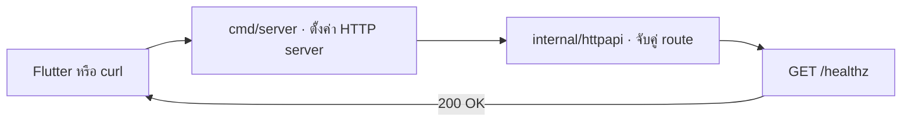

# PromptLearn Backend

Go HTTP service สำหรับทดสอบการเชื่อมต่อจาก Flutter ใช้ Go 1.24 ขึ้นไปและ standard library

## รัน service

รันจากโฟลเดอร์ `backend/`

```sh
go run ./cmd/server
```

เปิดอีก terminal เพื่อเรียก endpoint

```sh
curl -i http://127.0.0.1:8080/healthz
```

`GET /healthz` ตอบ HTTP 200 พร้อม JSON `{"status":"ok"}` เมื่อ HTTP service รับคำขอได้

ค่าเริ่มต้นฟังที่ `127.0.0.1:8080` กำหนด `HTTP_ADDR=0.0.0.0:8080` ได้เมื่อต้องทดสอบจากอุปกรณ์ในเครือข่ายเดียวกัน

## โครงสร้าง



`cmd/server` รับผิดชอบการเปิดพอร์ตและกำหนด timeout ส่วน `internal/httpapi` ประกอบ HTTP handler ให้ทดสอบได้โดยตรง เมื่อเพิ่ม API สำหรับวางแผนการสอนหรือรีวิวการบ้าน ให้ลงทะเบียน route ที่นี่และวางกติกาของแต่ละงานไว้ในแพ็กเกจของงานนั้น

## ทดสอบ

```sh
go test ./...
go vet ./...
```
