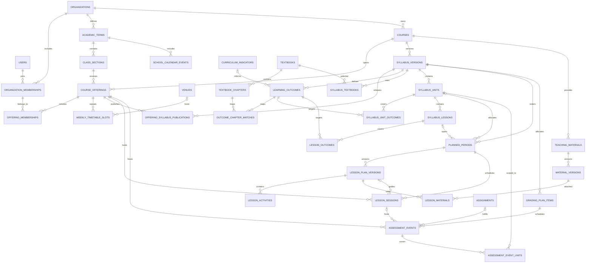
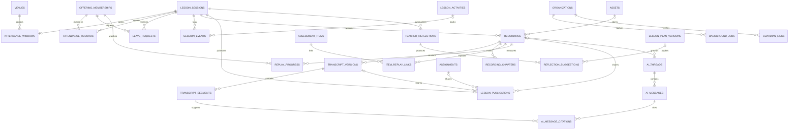
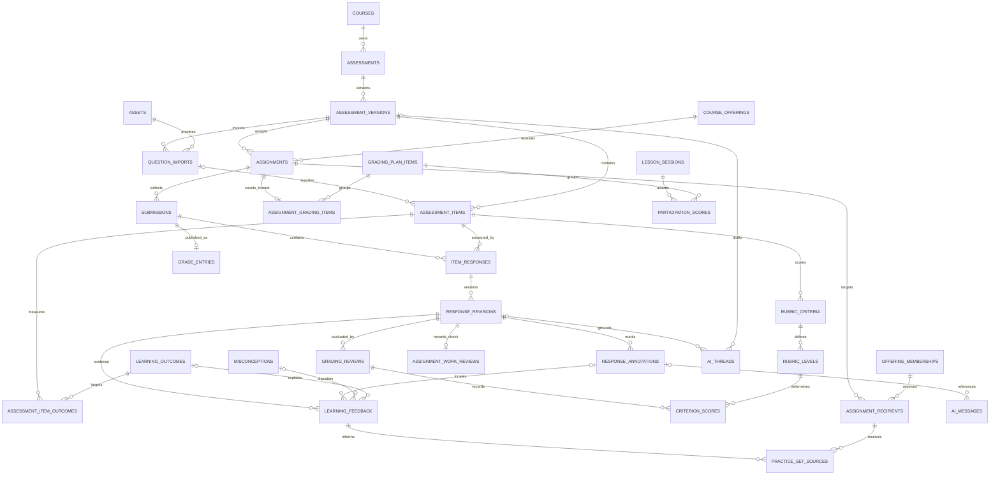

# PromptLearn ER diagram

ทั้งสามภาพใช้ชื่อตารางเดียวกับ PostgreSQL schema เส้นแสดงความสัมพันธ์หลักของแต่ละ flow ส่วนคอลัมน์และข้อกำหนดทั้งหมดอยู่ใน [schema.sql](./schema.sql)

## 1. ออกแบบการสอนและจัดตาราง

## 2. การสอน เช็กชื่อ และเรียนย้อนหลัง

## 3. การประเมิน วิธีทำ และ feedback

